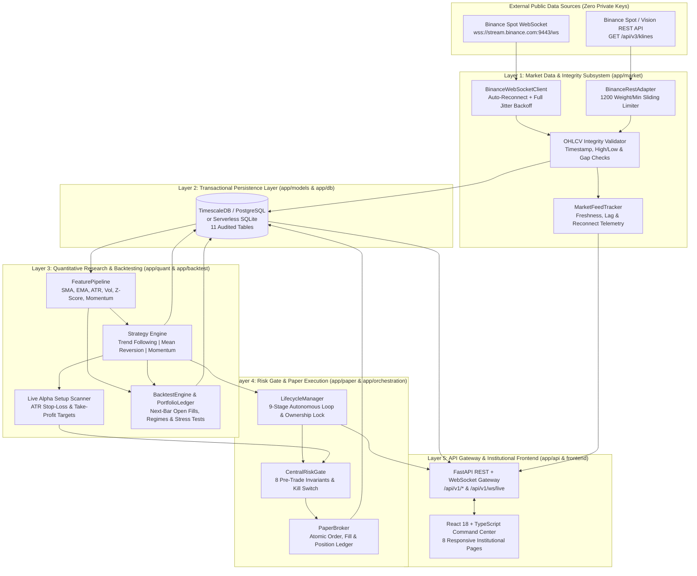
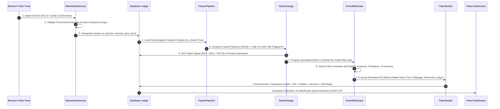
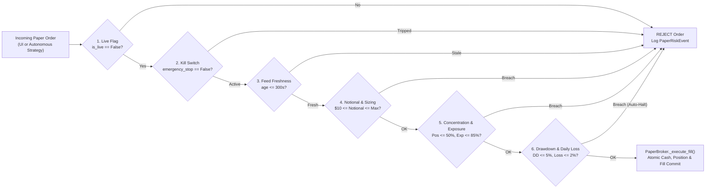
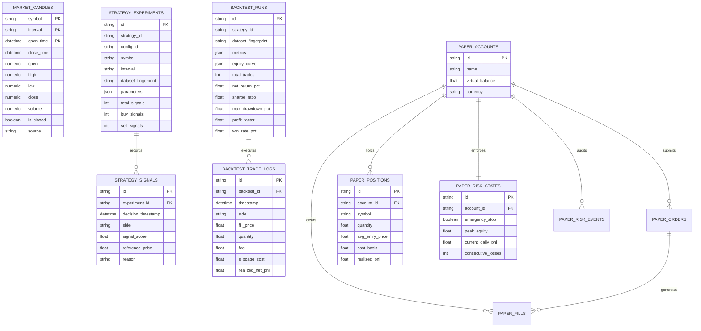

# ALPHA Quant — Institutional Quantitative Research, Backtesting & Paper Execution Platform

[](https://alpha-quant-trader.vercel.app)
[](https://alpha-quant-trader.vercel.app)
[](#)
[](#)
[](#)
[](#)
[](#)
[-emerald.svg)](#)

> **Live Cloud Deployment:** [https://alpha-quant-trader.vercel.app](https://alpha-quant-trader.vercel.app)  
> **Safety Invariant:** **ALPHA Quant** operates strictly on public market data and simulated paper execution (**₹0 / $0 real capital at risk**). Zero live exchange order-routing clients, withdrawal endpoints, or private API credentials exist anywhere in the codebase.

---

## 📑 Table of Contents

1. [Executive Overview](#-executive-overview)
2. [High-Level System Architecture](#-high-level-system-architecture)
3. [End-to-End 9-Stage Pipeline Design](#-end-to-end-9-stage-pipeline-design)
4. [Core Subsystem Engineering & Design](#-core-subsystem-engineering--design)
   - [1. Market Data Ingestion & Integrity Subsystem](#1-market-data-ingestion--integrity-subsystem)
   - [2. Causal Feature Engineering & Strategy Engine](#2-causal-feature-engineering--strategy-engine)
   - [3. Event-Driven Deterministic Backtesting Engine](#3-event-driven-deterministic-backtesting-engine)
   - [4. Central Pre-Trade Risk Gate & PaperBroker](#4-central-pre-trade-risk-gate--paperbroker)
   - [5. Lifecycle Orchestrator & Real-Time Telemetry](#5-lifecycle-orchestrator--real-time-telemetry)
   - [6. Institutional React/TypeScript Frontend](#6-institutional-reacttypescript-frontend)
5. [Database Schema & Entity-Relationship Design](#-database-schema--entity-relationship-design)
6. [REST & WebSocket API Reference](#-rest--websocket-api-reference)
7. [Monorepo Directory Structure](#-monorepo-directory-structure)
8. [Local Setup, Docker & Cloud Deployment](#-local-setup-docker--cloud-deployment)
9. [Testing, Failure Simulations & Security Audit](#-testing-failure-simulations--security-audit)

---

## 🏛️ Executive Overview

**ALPHA Quant** is a full-stack quantitative trading research, historical backtesting, real-time signal scanning, and simulated paper-execution platform engineered for BTC/USDT spot markets.

### Key Capabilities
- **Real-Time Market Data Pipeline:** Ingests public OHLCV candles (`1m`, `5m`, `15m`) from Binance Spot REST & WebSocket feeds with sliding-window rate limiting, sequence gap detection, and idempotent database upserts.
- **Zero-Lookahead Feature & Strategy Engine:** Computes 15+ technical and statistical factors (`SMA`, `EMA`, `ATR`, `Log Returns`, `Rolling Volatility`, `Z-Score`, `Multi-Period Momentum`, `Volume Z-Score`) and evaluates three institutional long-only spot strategies (**Trend Following**, **Mean Reversion**, and **Volatility-Normalized Momentum**).
- **Live Alpha Trade Setup Scanner:** Continuously evaluates real-time candles to compute actionable `BUY`/`SELL` trade setups with ATR-calibrated Entry, Stop-Loss (`SL`), Take-Profit (`TP1`/`TP2`), Risk/Reward ratios, and 1-click paper execution.
- **Deterministic Event-Driven Backtester:** Simulates chronological bar-by-bar execution strictly at next-bar `Open` ($t+1$), separating Gross P&L, Maker/Taker fees, and adverse slippage across 4 market regimes and 5 cost/latency stress scenarios.
- **Central Pre-Trade Risk Gate & PaperBroker:** Enforces 8 mandatory pre-trade risk invariants (order notional, position concentration, portfolio exposure, daily loss limit, max drawdown, consecutive loss streak, feed freshness, and spread filters) with an instant **Emergency Stop Kill Switch**.
- **Responsive Institutional UI:** 8 specialized command-center pages built with React 18, TypeScript (Strict Mode), and TailwindCSS, optimized for both multi-monitor desktop workstations and mobile devices.

---

## 🏗️ High-Level System Architecture

ALPHA Quant follows a strict **layered modular monolith** architecture with clear domain boundaries between market ingestion, quantitative research, backtest simulation, risk-gated paper execution, and presentation.



---

## 🔄 End-to-End 9-Stage Pipeline Design

Every market observation and simulated trade flows through an auditable **9-stage deterministic pipeline**:



---

## ⚙️ Core Subsystem Engineering & Design

### 1. Market Data Ingestion & Integrity Subsystem
Located in `backend/app/market/`, this subsystem guarantees that downstream quantitative models never consume corrupted, out-of-order, or unclosed candles:
- **Rate-Limited REST Backfill (`rest_adapter.py`, `rate_limiter.py`):** Implements a sliding-window rate limiter capped at `1,200` request weight per minute with automatic pagination and failover to `https://data-api.binance.vision`.
- **Resilient WebSocket Streaming (`ws_adapter.py`, `backoff.py`):** Connects to public Binance kline streams with exponential backoff and full random jitter ($t = \text{random}(0, \min(T_{\max}, T_0 \cdot 2^n))$).
- **Strict OHLCV Validation (`validator.py`):** Enforces:
  - $\text{close\_time} > \text{open\_time}$
  - $\text{high} \ge \max(\text{open}, \text{close})$ and $\text{low} \le \min(\text{open}, \text{close})$
  - $\text{open}, \text{high}, \text{low}, \text{close} > 0$ and $\text{volume} \ge 0$
- **Idempotent Storage (`service.py`):** Uses `ON CONFLICT (symbol, interval, open_time) DO UPDATE` so duplicate deliveries or restart backfills never create duplicate rows.

### 2. Causal Feature Engineering & Strategy Engine
Located in `backend/app/quant/`, this subsystem transforms validated candles into alpha signals:
- **Zero Look-Ahead Guarantee (`features/pipeline.py`):** Filter rejects unclosed (`is_closed=False`) candles before computing rolling features (`SMA`, `EMA`, `Simple/Log Returns`, `Rolling Volatility`, `Rolling Z-Score`, `ATR-14`, `Volume Ratio`, `Multi-Period Momentum`). Modifying bar $t+1$ mathematically cannot alter features or signals at bar $t$.
- **Cryptographic Dataset Fingerprinting (`experiments/tracker.py`):** Every dataset slice is hashed with SHA-256 across `(symbol, interval, count, start, end, OHLCV_rows)` so every experiment and backtest run is 100% reproducible.
- **Three Institutional Spot Strategies (`strategy/`):**
  1. **Trend Following (`trend_following.py`):** Dual moving-average crossover (`fast_window=20`, `slow_window=100`) gated by a rolling volatility filter (`max_volatility`) to avoid high-chop whipsaws.
  2. **Mean Reversion (`mean_reversion.py`):** Enters oversold dips when rolling Z-score drops below entry threshold while a long-term regime filter (`close >= 0.90 * SMA_100`) prevents catching falling knives.
  3. **Volatility-Normalized Momentum (`momentum.py`):** Blends multi-horizon momentum (`5, 15, 60` bars), normalizes by rolling return volatility, and enforces a transaction-cost hurdle ($\ge 2\times$ round-trip fees).

### 3. Event-Driven Deterministic Backtesting Engine
Located in `backend/app/backtest/`, the backtester models realistic institutional execution:
- **Next-Bar Open Execution (`engine.py`, `execution.py`):** Signals generated at the close of bar $t$ queue orders that execute strictly at the `Open` of bar $t+1$ (plus configurable latency delay bars).
- **Explicit Cost Model (`cost_model.py`):** Separates Maker fees, Taker fees, adverse slippage, half-spread penalties, and bar-volume liquidity participation caps:
  $$\text{FillPrice}_{\text{BUY}} = P_{\text{open}, t+1} \cdot \left(1 + \frac{\text{slippage\_bps} + \text{spread\_bps}/2}{10000}\right)$$
  $$\text{FillPrice}_{\text{SELL}} = P_{\text{open}, t+1} \cdot \left(1 - \frac{\text{slippage\_bps} + \text{spread\_bps}/2}{10000}\right)$$
- **Portfolio Accounting Invariants (`accounting.py`):** Enforces on every bar $t$:
  $$\text{TotalEquity}_t = \text{Cash}_t + \sum \text{PositionsValue}_t$$
  $$\text{NetPnL}_t = \text{GrossPnL}_t - \text{CumulativeFees}_t - \text{CumulativeSlippage}_t$$
- **Regime & Stress Matrix (`validation.py`, `analytics.py`):** Automatically segments performance across `Bullish`, `Bearish`, `Choppy`, and `High Volatility` market regimes and runs 5 stress scenarios (`high_fee_2x`, `high_fee_5x`, `high_slippage_3x`, `severe_stress`, and `delayed_execution_1bar`) alongside 500-iteration bootstrap 95% confidence intervals.

### 4. Central Pre-Trade Risk Gate & PaperBroker
Located in `backend/app/paper/`, every simulated order must pass through `CentralRiskGate` before reaching `PaperBroker`:



### 5. Lifecycle Orchestrator & Real-Time Telemetry
Located in `backend/app/orchestration/`:
- **Single-Owner Autonomous Scheduler (`lifecycle.py`):** Runs background paper-trading evaluation cycles with an explicit ownership lock (`worker_id`, `active_task_id`). Concurrent start attempts return `HTTP 409 Conflict`.
- **Live WebSocket Hub (`api/v1/endpoints/ws_live.py`):** Streams real-time portfolio, risk, and market snapshots over `/api/v1/ws/live` with automatic REST fallback (`/api/v1/live/fallback`).

### 6. Institutional React/TypeScript Frontend
Located in `frontend/src/`, built with **React 18**, **TypeScript Strict Mode**, and **TailwindCSS**:
1. **Overview (`/`):** Live BTC/USDT HUD, Virtual Equity, Net P&L, Live Alpha Trade Setup Scanner with 1-click BUY/SELL execution, Recent Signals, Risk Events, and Subsystem Health.
2. **Markets (`/markets`):** Interactive HTML5 Canvas Candlestick Chart (`1m`, `5m`, `15m`) with SMA-20, SMA-100, EMA-12 overlays, `▲/▼` Strategy Signal Markers, ATR/Volatility diagnostics, and Historical Backfill controls.
3. **Strategies (`/strategies`):** Strategy registry, parameter configuration, autonomous paper-trading start/stop controls, and persisted evaluation ledger.
4. **Backtesting (`/backtests`):** Deterministic simulation launcher, interactive Equity & Drawdown curve visualization, 4-regime performance breakdown, 5-scenario stress test table, trade log, and CSV/JSON export.
5. **Paper Trading (`/portfolio`):** Virtual capital allocation (`$10k / $25k / $50k / $100k`), manual Market/Limit order ticket, open position inventory with 1-click Flatten, order book, and fill history.
6. **Risk Management (`/risk`):** Real-time utilization bars for exposure, drawdown, daily loss, and feed age, plus the prominent **Emergency Stop Kill Switch** and two-step administrative resume modal.
7. **Experiments (`/experiments`):** Reproducible SHA-256 dataset fingerprints, hyperparameter audit logs, and signal inspection.
8. **System Health (`/health`):** Database latency probes, collector reconnection telemetry, background task queue monitor, and audit log viewer.

---

## 🗄️ Database Schema & Entity-Relationship Design

The persistence layer uses SQLAlchemy 2.0 Async ORM (`backend/app/models/`) with full Alembic migration support (`backend/alembic/versions/0001` through `0005`):



---

## 🔌 REST & WebSocket API Reference

| Category | Method | Endpoint | Description |
| :--- | :---: | :--- | :--- |
| **Health & Probes** | `GET` | `/health`, `/ready` | Liveness & multi-dependency readiness probes |
| **Market Data** | `GET` | `/api/v1/market/candles` | Query validated OHLCV candles (`1m`, `5m`, `15m`) |
| **Market Data** | `GET` | `/api/v1/market/status` | Feed connectivity, lag, and freshness telemetry |
| **Market Data** | `POST` | `/api/v1/market/backfill` | Trigger historical REST candle backfill *(Auth)* |
| **Strategies** | `GET` | `/api/v1/strategies` | List registered quantitative strategies & schemas |
| **Strategies** | `GET` | `/api/v1/strategies/live-scanner` | Real-time BUY/SELL setups with ATR SL & TP1/TP2 |
| **Strategies** | `POST` | `/api/v1/strategies/run` | Execute strategy & persist experiment signals *(Auth)* |
| **Experiments** | `GET` | `/api/v1/experiments` | List reproducible experiments & SHA-256 hashes |
| **Backtesting** | `POST` | `/api/v1/backtests` | Run event-driven simulation & stress tests *(Auth)* |
| **Backtesting** | `GET` | `/api/v1/backtests` | List persisted backtest runs & summary metrics |
| **Backtesting** | `GET` | `/api/v1/backtests/{run_id}` | Full backtest report, equity curve & trade ledger |
| **Paper Execution** | `GET` | `/api/v1/portfolio` | Virtual cash, open positions, mark-to-market P&L |
| **Paper Execution** | `POST` | `/api/v1/paper/orders` | Submit risk-gated simulated Market/Limit order *(Auth)* |
| **Paper Execution** | `POST` | `/api/v1/paper/account/reset` | Reset virtual capital (`$10k–$100k`) *(Auth)* |
| **Orchestration** | `POST` | `/api/v1/paper-trading/start` | Start autonomous paper-trading scheduler *(Auth)* |
| **Orchestration** | `POST` | `/api/v1/paper-trading/stop` | Stop autonomous paper-trading scheduler *(Auth)* |
| **Risk Control** | `GET` | `/api/v1/risk/status` | Central Risk Gate limits, drawdown & feed health |
| **Risk Control** | `POST` | `/api/v1/paper/risk/emergency-stop` | Engage immediate circuit breaker halt *(Auth)* |
| **Risk Control** | `POST` | `/api/v1/paper/risk/resume` | Clear emergency stop with admin confirmation *(Auth)* |
| **Live Stream** | `WS` | `/api/v1/ws/live` | Real-time bi-directional telemetry WebSocket |

---

## 📂 Monorepo Directory Structure

```text
ALPHA-QUANT-TRADER/
├── api/
│   └── index.py                     # Vercel Serverless Python ASGI entrypoint
├── backend/
│   ├── alembic/                     # Database schema migrations (0001 - 0005)
│   ├── app/
│   │   ├── api/v1/endpoints/        # FastAPI REST & WebSocket route controllers
│   │   ├── backtest/                # Event-driven backtest engine, ledger & cost model
│   │   ├── cli/                     # CLI runners (ingest, strategy, backtest, paper)
│   │   ├── core/                    # Config, security, structured logging & exceptions
│   │   ├── db/                      # Async SQLAlchemy engine & session management
│   │   ├── market/                  # Binance REST/WS adapters, validator & rate limiter
│   │   ├── models/                  # SQLAlchemy ORM models (11 tables)
│   │   ├── orchestration/           # Autonomous lifecycle manager & async task queue
│   │   ├── paper/                   # PaperBroker & Central Pre-Trade Risk Gate
│   │   ├── quant/                   # FeaturePipeline, strategies & experiment tracker
│   │   └── main.py                  # FastAPI application factory & lifespan hooks
│   ├── tests/                       # 124 automated unit, integration, failure & security tests
│   ├── Dockerfile                   # Multi-stage non-root backend container
│   └── requirements.txt             # Pinned Python dependencies
├── frontend/
│   ├── public/logo.svg              # Vector black-and-gold ALPHA shield emblem
│   ├── src/
│   │   ├── components/              # AppShell, AppHeader, AppSidebar, Logo, HealthBadge
│   │   ├── pages/                   # 8 institutional pages (Overview, Markets, Backtest, etc.)
│   │   ├── services/api.ts          # Strongly-typed REST client with auth headers
│   │   └── types/index.ts           # Strict TypeScript interfaces
│   ├── Dockerfile                   # Production Nginx frontend container
│   └── vite.config.ts               # Vite bundler & proxy configuration
├── docker-compose.yml               # Full stack (TimescaleDB + Backend + Frontend)
├── vercel.json                      # Vercel hybrid serverless + SPA routing config
└── README.md                        # System architecture & engineering documentation
```

---

## 🚀 Local Setup, Docker & Cloud Deployment

### Option A: Quick Local Development (SQLite + FastAPI + Vite)

1. **Start the FastAPI Backend (`port 8000`):**
   ```powershell
   cd backend
   python -m venv .venv
   .\.venv\Scripts\pip install -r requirements.txt
   .\.venv\Scripts\python.exe -m uvicorn app.main:app --host 0.0.0.0 --port 8000 --reload
   ```

2. **Start the React/Vite Frontend (`port 5174`):**
   ```powershell
   cd frontend
   npm install
   npx vite --port 5174 --host 0.0.0.0
   ```
   Open [http://localhost:5174](http://localhost:5174) (Swagger API docs at [http://localhost:8000/docs](http://localhost:8000/docs)).

### Option B: Full Containerized Stack (Docker Compose + TimescaleDB)

```powershell
cp .env.example .env
docker compose up -d --build
```
- **Frontend UI:** `http://localhost:8080`
- **Backend API:** `http://localhost:8000`
- **TimescaleDB (PostgreSQL 16):** `localhost:5432`

### Option C: Vercel Serverless Production Deployment

The repository includes `vercel.json` and `api/index.py` for zero-configuration deployment to Vercel:
```powershell
npx vercel --prod --yes
```

---

## 🧪 Testing, Failure Simulations & Security Audit

The platform is verified by **124 automated tests** across 25 test suites covering unit, integration, failure modes, and security invariants:

```powershell
# Run full backend test suite (124 tests)
cd backend
.\.venv\Scripts\python.exe -m pytest -q

# Run frontend strict TypeScript verification & production build
cd ../frontend
npm run typecheck
npm run build
```

### Verified Failure Modes & Security Invariants
- **12 Failure Simulations (`tests/test_failure_simulations.py`):** Market-data disconnection, sequence gap detection, stale feed rejection, readiness probe under outage, restart state preservation, duplicate `client_order_id` idempotency, duplicate fill prevention, insufficient virtual cash rejection, emergency stop circuit breaker, HTTP 422 payload validation, HTTP 401 unauthorized mutation rejection, and background worker fault isolation.
- **5 Automated Security Audits (`tests/test_security_audit.py`):** Verifies zero live exchange clients or withdrawal methods exist in `app/`, all financial tables are strictly paper-isolated, the frontend cannot bypass `CentralRiskGate`, probing live order routes returns `404`, and zero private keys are present in configuration.
